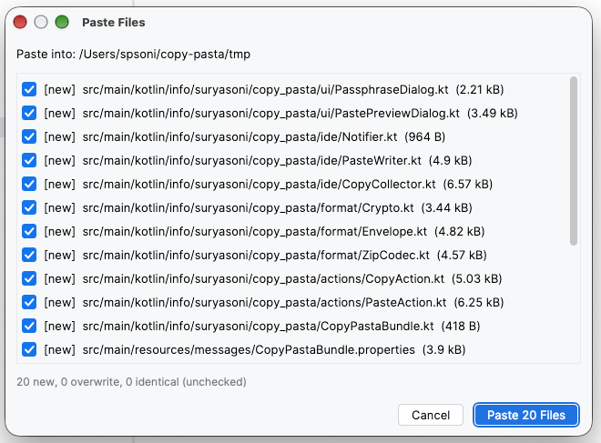

<p align="center">
  <picture>
    <source media="(prefers-color-scheme: dark)" srcset="src/main/resources/META-INF/pluginIcon_dark.svg">
    
  </picture>
</p>

<h1 align="center">Copy-Pasta</h1>

<p align="center">
  <strong>Send files and folders through any chat, and get them back as real files in another JetBrains IDE.</strong>
</p>

<p align="center">
  <a href="https://github.com/spsoni/copy-pasta/actions/workflows/build.yml"></a>
  <a href="https://github.com/spsoni/copy-pasta/releases/latest"></a>
  <a href="LICENSE"></a>
</p>

<!-- Plugin description -->
**Copy-Pasta** sends files and folders through any chat. It packs your selection into a single block of text for Slack, Teams, email, a forum or a support ticket. The recipient copies that text and pastes it into their IDE, where it becomes the same files again. They see exactly what will be written first.

No repository, file-sharing service or account is needed. Copy-Pasta works offline and sends no data anywhere.

**How it works**

1. **Copy.** In the Project view, right-click files or folders and choose **Copy-Pasta | Copy**.
2. **Send.** Paste the text into a chat, email or ticket.
3. **Copy it on the other side.** The recipient selects the whole message, from `BEGIN COPY-PASTA` to `END COPY-PASTA`, and copies it. Copy-Pasta reads the clipboard, not the chat window. A clipboard icon in the status bar confirms that the text is ready.
4. **Paste.** Right-click the target folder, choose **Copy-Pasta | Paste…**, review the preview and confirm. Or click the status bar icon and choose where to paste.

**Why Copy-Pasta**

Code pasted into chat loses its folder structure, gets re-wrapped and reformatted, and is silently cut off when it's too long. Attachments get blocked or expire, and a branch only helps people who share your repository. Copy-Pasta moves a whole folder tree as plain text and restores it byte for byte. If the message was cut off, it tells you so instead of writing broken files.

- **Reproducers** that a colleague can run, not just read.
- **Configs, build setups and scaffolds** for people outside your repository.
- **Work between machines**, including locked-down environments where chat is the only way in.
- **Complete examples** on forums and in support tickets, in a single message.

**Safe by design**

- **Preview before writing.** Every file is marked *new*, *overwrite* or *identical*, and you can untick any of them. Executable files and unusual permissions (such as `rw-------`) are flagged.
- **One-step undo.** Each paste is a single Local History checkpoint.
- **Path protection.** Entries that would escape the target folder or write into `.git` are blocked.
- **Optional encryption.** **Copy Encrypted…** protects the content with a passphrase (AES-256-GCM, PBKDF2 with 600,000 iterations). The passphrase is never stored.
- **Your clipboard, your call.** Copy-Pasta never changes the clipboard on its own. The status bar icon's **Clear from Clipboard** removes Copy-Pasta text from the clipboard and the IDE's clipboard history when you're done.

**Smart and lightweight**

- Honours `.gitignore`, excluded folders and the IDE's ignored files. Anything you select explicitly is always included.
- Includes unsaved editor changes.
- Survives email quoting, line re-wrapping and surrounding chat text.
- Handles long selections: **Save as File…** (named with the local date and time), and the recipient opens it from the Paste dialog.
- Keeps file permissions on macOS and Linux: scripts stay runnable and private keys stay private. For safety, pasted files are never writable by group or others, never more open than your umask allows, the owner can always edit them, and special bits (setuid and the like) are never applied. Owners and timestamps aren't copied.
- Uses a standard ZIP inside, so your content is never locked in.
- Has no settings and no dependencies, and does its work in the background.

Works in IntelliJ IDEA, PyCharm, WebStorm, GoLand, Rider, CLion, PhpStorm, RubyMine, DataGrip, Android Studio and other JetBrains IDEs, version 2025.3 or later.
<!-- Plugin description end -->

> [!IMPORTANT]
> **Paste reads your clipboard.** Copy the entire message you received, including the `BEGIN` and `END` lines, before you paste. A clipboard icon appears in the status bar when the text is ready. If the clipboard holds something else, **Paste…** asks you to paste the message or open a file.



**[Read the user guide](docs/user-guide.md)**: copying and pasting, encryption, long selections, undo, and troubleshooting.

## Installation

- **JetBrains Marketplace**: Settings | Plugins | Marketplace, then search for "Copy-Pasta".
- **Manual**: download the ZIP from [Releases](https://github.com/spsoni/copy-pasta/releases), then go to Settings | Plugins | ⚙️ | Install Plugin from Disk…

## What the text looks like

```
-----BEGIN COPY-PASTA-----
Copy-Pasta: 3 files, 4.1 KB. Paste it with the Copy-Pasta plugin for JetBrains IDEs: https://github.com/spsoni/copy-pasta
Format: 2; length: 5612
UEsDBBQACAgIA...                      (Base64, 76 characters per line)
-----END COPY-PASTA-----
```

- The body is Base64 of a ZIP. File paths are relative to the selection. Permissions are stored in a private ZIP extra field (`0x4350`): byte 0 is the executable flag (all that 2.0 wrote), and bytes 1–2 hold the nine `rwxrwxrwx` bits (2.1 and later). Owners and timestamps aren't stored.
- `BEGIN COPY-PASTA ENCRYPTED` means the body is `CPv2` | PBKDF2 iteration count (int32) | 16-byte salt | 12-byte IV |
  AES-256-GCM ciphertext and tag. The key comes from the passphrase via PBKDF2-HMAC-SHA256 (600,000 iterations by default).
- `length` lets the plugin detect a message cut off by a chat app.
- Copy-Pasta 1.x text (raw Base64 tar.gz) can't be pasted with 2.x.

Size limits: 10 MB per file and 50 MB per copy. A notification warns when the text is longer than chat apps usually allow (about 35k characters).

## Development

Requires JDK 21; Gradle comes from the wrapper. On macOS, `make setup-mac` installs JDK 21, the GitHub CLI and the
workflow linters with Homebrew (see [Brewfile](Brewfile)) and enables the pre-commit hook. It takes a few minutes with
Homebrew at its default prefix (`/opt/homebrew`); elsewhere, some JDK dependencies build from source. Run `make help` to
list every target.

```bash
make check     # ktlint + unit and platform tests
make build     # plugin ZIP in build/distributions/
make run       # sandbox IDE with the plugin installed (needs a display)
make verify    # IntelliJ Plugin Verifier against the supported IDEs
make release VERSION=2.0.1   # bump version, date the changelog, commit and tag
```

Releases are tag-based. Pushing a `vX.Y.Z` tag runs [release.yml](.github/workflows/release.yml), which tests, verifies, signs,
publishes to the Marketplace and creates the GitHub release. The Marketplace description is the `Plugin description` block
above; the change notes come from [CHANGELOG.md](CHANGELOG.md).

## Feedback and contributions

Bug reports and pull requests are welcome. Please [open an issue](https://github.com/spsoni/copy-pasta/issues).

## License

[MIT](LICENSE)
