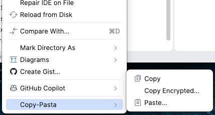
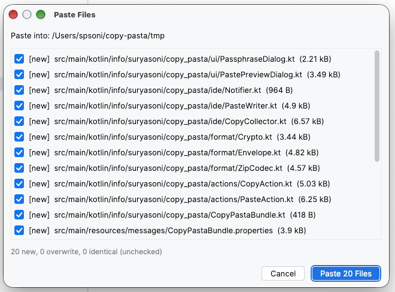
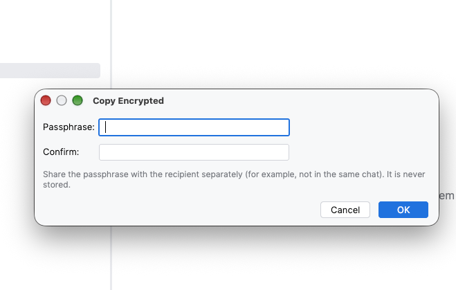
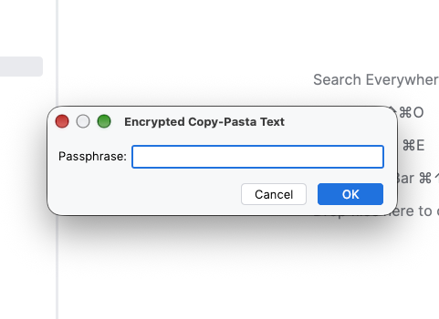
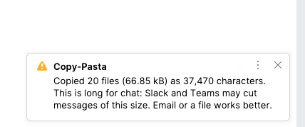

# Copy-Pasta user guide

Copy-Pasta moves files and folders between JetBrains IDEs as a block of text that you send through any chat, email or
ticket.

## Quick start

| | Sender | Recipient |
|---|---|---|
| 1 | Right-click files or folders → **Copy-Pasta \| Copy** | Select the **whole** message, `BEGIN` to `END`, and copy it |
| 2 | Paste the text into a chat, email or ticket | Right-click the target folder → **Copy-Pasta \| Paste…** |
| 3 | | Review the preview → **Paste N Files** |

> [!IMPORTANT]
> **Paste reads your clipboard, not the chat window.** Copy the message first. When the clipboard holds Copy-Pasta
> text, a clipboard icon appears in the status bar at the bottom of the IDE window.

## Contents

- [Copy files](#copy-files)
- [Paste files](#paste-files)
- [The status bar icon](#the-status-bar-icon)
- [Encrypt with a passphrase](#encrypt-with-a-passphrase)
- [Long text and chat limits](#long-text-and-chat-limits)
- [What gets copied](#what-gets-copied)
- [Undo a paste](#undo-a-paste)
- [Troubleshooting](#troubleshooting)
- [Without the plugin](#without-the-plugin)

## Copy files

1. In the **Project** view, select one or more files or folders.
2. Right-click and choose **Copy-Pasta | Copy**.
3. Paste the text into a chat, email or ticket. The first line explains what it is and links to this project, so a
   recipient who doesn't have the plugin knows where to get it.



A notification confirms how many files were copied and how long the text is. Copying runs in the background, so
large selections don't freeze the IDE.

## Paste files

1. **Copy the message you received.** Select the whole block, from `-----BEGIN COPY-PASTA-----` to
   `-----END COPY-PASTA-----`, and press <kbd>Ctrl</kbd>+<kbd>C</kbd> (<kbd>⌘</kbd>+<kbd>C</kbd> on macOS). It's fine to
   include text around it, such as the rest of a chat message or `>` quote marks from an email reply: Copy-Pasta
   ignores it. Chat apps often collapse long messages, so expand the message before you select it.
2. In the **Project** view, right-click the folder to paste into and choose **Copy-Pasta | Paste…**. You can also use
   **Edit | Paste Files from Copy-Pasta…**. If you right-click a file, the paste goes into the folder containing it.
   With nothing selected, it goes into the project root. When the clipboard holds Copy-Pasta text, the menu item
   shows what it contains, for example **Paste… (3 files, 4.1 KB)**.
3. Review the preview and choose **Paste N Files**.

If the clipboard holds something else when you choose **Paste…**, the **Paste Copy-Pasta Text** dialog opens instead.
Paste the message into it, or choose **Open File…** to load a `.txt` attachment. A message that is cut off or damaged
is reported in the dialog, so you can fix it before going on. If the clipboard text turns out to be cut off, the error
notification offers **Paste Text or Open File…**, which opens the same dialog.



The preview marks every file:

| Mark | Meaning | Checked by default |
|---|---|---|
| **new** | No file exists at that path yet. | Yes |
| **overwrite** | A file exists there with different content. It will be replaced. | Yes |
| **identical** | A file exists there with the same content. Nothing to do. | No |
| **executable** | The file has the executable bit set (for example a shell script). | — |

Uncheck anything you don't want. Nothing is written until you confirm. Afterwards, **Show** in the notification
opens the pasted files.

For your safety, the paste skips entries that would land outside the target folder, write into `.git` or another
version-control folder, or clash with an existing file or folder of a different kind. The preview tells you when
this happens.

## The status bar icon

A clipboard icon in the status bar shows when there is Copy-Pasta text to paste:

| Icon | Meaning |
|---|---|
| Appears with a short pulse | New Copy-Pasta text is on the clipboard. Hover over it to see what it contains. |
| Appears steadily after you copy | Your own copy is ready to send. Clicking it does nothing, so you don't paste your files back by accident. |
| Dimmed | This text has already been pasted. Click to paste it again. |
| Fades out | The clipboard now holds something else. |

Click the icon to paste into the project root, after the usual preview. To paste somewhere else, right-click that
folder and choose **Copy-Pasta | Paste…**.

The IDE notices text copied in another app when you switch back to its window, so the icon appears at that moment.
Copy-Pasta never changes or clears your clipboard. To hide the icon, right-click the status bar and untick
**Copy-Pasta Clipboard**.

## Encrypt with a passphrase

Use **Copy-Pasta | Copy Encrypted…** when the files shouldn't sit readable in a chat history.



Enter a passphrase twice. The text then starts with `BEGIN COPY-PASTA ENCRYPTED`, and pasting it asks for the
passphrase:



- **Send the passphrase through a different channel** from the text, for example by phone or a different chat app.
  Anyone who has both can read the files.
- The passphrase is never stored, by either side. If it's lost, the content can't be recovered.
- The content is encrypted with AES-256-GCM, using a key derived with PBKDF2-HMAC-SHA256 (600,000 iterations). A
  wrong passphrase and tampered text give the same error, and nothing is written. See [SECURITY.md](../SECURITY.md)
  for the threat model.

## Long text and chat limits

The text is about a third larger than the zipped files. Chat apps cap message length, and Slack and Teams
start cutting messages at around 35,000 characters, so Copy-Pasta warns you above that:



For a long copy, choose **Save as File…** in that notification and send the `.txt` file as an attachment, or send the
text by email. The recipient chooses **Copy-Pasta | Paste…**, then **Open File…** in the dialog that opens. If a
message does get cut off, Paste says it is incomplete, with the number of characters that arrived. It never writes
broken files.

Limits: 10 MB per file and 50 MB per copy. Copy-Pasta is meant for snippets, reproducers and small projects, not for
replacing a repository.

## What gets copied

Copy-Pasta uses the IDE's own idea of what belongs to the project, so there's nothing to configure:

- **Skipped:** files ignored by your version control (`.gitignore` and the like), folders marked **Excluded**
  (such as `build/` or `node_modules/` in most projects) and files listed under **Settings | Editor | File Types |
  Ignored Files and Folders**. The notification says how many were skipped.
- **Always included:** anything you selected explicitly, even if it's ignored or excluded. To copy a `build/`
  folder, select it.
- **Unsaved changes** in open editors are included, so what you see is what you send.
- The **executable bit** is kept. Other permissions, timestamps and empty folders are not.

## Undo a paste

Every paste is preceded by a Local History label, **Before Copy-Pasta paste**. To undo the whole paste, right-click
the target folder and choose **Local History | Show History**. Then select that label and choose **Revert**. This
also works if a paste stopped part-way through.

## Troubleshooting

| Message | What to do |
|---|---|
| *This isn't Copy-Pasta text* (in the Paste dialog) | Paste the whole message, including both the BEGIN and END lines. |
| *The Copy-Pasta text is incomplete* | The chat app cut the message. Ask the sender to use **Save as File…** and send the file. |
| *The Copy-Pasta text is damaged* | Something changed the text in transit. Ask the sender to copy it again. |
| *Made by a newer version of Copy-Pasta* | Update the plugin: **Settings \| Plugins \| Installed**. |
| *Wrong passphrase, or the text was changed* | Check the passphrase with the sender. If it's right, the text was altered: ask for it again. |
| *Nothing to copy* | Every selected file is ignored or excluded. Select the files themselves. |
| **Paste…** is greyed out or missing | Open a project, and pick a folder you can write to. |

Text copied with Copy-Pasta 1.x can't be pasted with 2.x. Ask the sender to update and copy again.

## Without the plugin

The content is a standard ZIP file encoded as Base64, so you can unpack unencrypted text with any shell:

```bash
# Save the whole block as copy.txt, then:
sed -n '/^Format:/,/^-----END/{//!p;}' copy.txt | base64 -d > files.zip
unzip files.zip
```

The text format is described in the [README](../README.md#what-the-text-looks-like).
